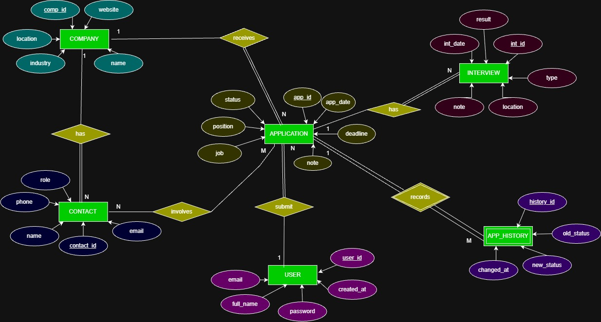

# Design Document
submit50 cs50/problems/2024/sql/project

By Nibel Hammadi

Video overview: <https://www.youtube.com/watch?v=wfbeqyj69VU>

## Scope# Application Tracker Database

Hello everyone! My name is Nibel Hammadi.

This is my final project for CS50 SQL, and it is called **Application Tracker Database**.

The idea of this project is simple: to help people organize their job and internship applications in one place.

When applying to different companies, it can be difficult to remember where you applied, when you applied, and what happened after that. My database helps solve this problem.

My database contains seven tables.

The USER table stores user information, and the COMPANY table stores company details.

The APPLICATION table stores application information, including the position, application date, and current status.

I also created tables to manage company contacts, connect contacts to applications, store interview details, and keep track of status changes.

Here, you can see my Entity-Relationship Diagram, which shows all the tables and how they are connected.

In my schema.sql file, I created all the tables and their relationships. I also added indexes, views, and a trigger.

The views help retrieve useful information, such as application statistics and upcoming deadlines. The trigger automatically records changes in application status.

Finally, my queries.sql file contains different SQL queries to insert, update, delete, and retrieve data.

Through this project, I learned how to design and build a database for a real-life problem using SQL.

Thank you for watching!

In this section you should answer the following questions:

* What is the purpose of your database?

    The purpose of this database is to provide a centralized system for tracking internship
    and job applications. It helps users organize their applications, monitor their progress
    manage company contacts, schedule interviews, and keep track of application status changes
    and upcoming deadlines

* Which people, places, things, etc. are you including in the scope of your database?

The database includes the following elements:

    Users:  People who use the application to manage their job and internship applications.
    Companies:  Organizations to which users submit applications
    Applications:  Job or internship opportunities submitted by users
    Contacts:  People working at companies who may be associated with applications
    Interviews:  Interviews scheduled for specific applications
    Application History:  Records of changes in the status of applications

* Which people, places, things, etc. are *outside* the scope of your database?

## Functional Requirements

In this section you should answer the following questions:

* What should a user be able to do with your database?
    Create and manage an account.
    Add, update, and delete applications.
    Manage company and contact information
    Track application statuses
    Schedule interviews
    View application history
    Search and filter applications
    Check upcoming deadlines

* What's beyond the scope of what a user should be able to do with your database?

    Users cannot automatically submit applications OR receive notifications
## Representation

### Entities

In this section you should answer the following questions:

* Which entities will you choose to represent in your database?

    USER: Stores information about users
    COMPANY: Stores information about companies
    APPLICATION: Stores job and internship applications
    CONTACT: Stores information about company contacts
    APPLICATION_CONTACT: Connects applications with contacts
    INTERVIEW: Stores information about scheduled interviews
    APP_HISTORY: Stores application status changes

* What attributes will those entities have?

    USER: user_id, full_name, email, password, created_at
    COMPANY: comp_id, name, industry, location, website
    APPLICATION: app_id, user_id, comp_id, position, job, status, app_date, deadline, note
    CONTACT: contact_id, comp_id, name, role, email, phone
    APPLICATION_CONTACT: app_id, contact_id
    INTERVIEW: int_id, app_id, int_date, type, location, result, note
    APP_HISTORY: app_id, history_id, old_status, new_status, changed_at

* Why did you choose the types you did?

    INT: For IDs because they are numbers
    VARCHAR: For short text such as names, emails, and locations
    DATE: For application dates and deadlines
    DATETIME: For dates that also need a time
    TEXT: For longer notes
    ENUM: For application statuses because they have predefined values

* Why did you choose the constraints you did?

    PRIMARY KEY: To uniquely identify each record
    FOREIGN KEY: To connect related tables
    NOT NULL: To make sure required information is provided
    UNIQUE: To prevent duplicate email addresses
    AUTO_INCREMENT: To generate IDs automatically
    ON DELETE CASCADE: To automatically delete dependent records when their parent record is deleted

### Relationships

In this section you should include your entity relationship diagram and describe the relationships between the entities in your database.

    One user can have multiple applications, but each application belongs to one user

    One company can receive multiple applications, but each application is associated with one company

    One company can have multiple contacts, but each contact belongs to one company

    One application can be associated with multiple contacts, and one contact can be associated with multiple applications. This relationship is implemented using APPLICATION_CONTACT

    One application can have multiple interviews, but each interview belongs to one application

    One application can have multiple history records, but each history record belongs to one application

    Entity Relationship Diagram:
 

## Optimizations

In this section you should answer the following questions:

* Which optimizations (e.g., indexes, views) did you create? Why?

    We created an index named idx_application_status on the status column in APPLICATION
    It helps make searches and filters by application status faster

    We created five views to simplify common queries:
    status_summary: Displays the total number of applications for each status
    application_details: Displays application information with company names
    user_application: Displays users and their applications
    upcoming_deadlines: Displays applications with upcoming deadlines
    application_contacts: Displays contacts associated with applications

    We created a trigger named after_application_status_update. It automatically records the old status
     new status, and date of a status change in APP_HISTORY
     and we used primary keys, foreign keys, UNIQUE, and NOT NULL constraints to maintain data accuracy and consistency
## Limitations

In this section you should answer the following questions:

* What are the limitations of your design?

   The database focuses mainly on organizing and tracking applications
    It does not support automatic job searching, notifications, document upload

* What might your database not be able to represent very well?

    The database stores basic information about job opportunities, but it does not cover all their details
    such as required skills, salary, job descriptions, or recruitment requirements
    It also records only changes in application status, not every modification made to an application
