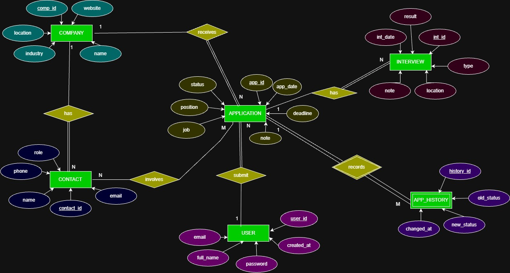

# Application Tracker Database

<text> A MySQL relational database for organizing and tracking job and internship applications, managing company contacts, scheduling interviews, and monitoring application progress.</text>

**Harvard CS50's Introduction to Databases with SQL — Final Project**

[](https://www.mysql.com/)
[](https://www.w3.org/TR/sql-2/)
[](https://cs50.harvard.edu/sql/)

---

## Overview

Keeping track of multiple job and internship applications can become challenging. Applicants often need to remember which companies they contacted, the positions they applied for, interview schedules, application deadlines, and the status of each application.

**Application Tracker Database** is a relational database designed to organize this information in one centralized place.

The database allows multiple users to manage their applications independently while maintaining information about companies, professional contacts, interviews, and application status history.

It also provides useful views and queries to retrieve application statistics, search opportunities, and monitor upcoming deadlines.

The project was developed using MySQL as the final project for Harvard's CS50 Introduction to Databases with SQL.

## Features

- **User Management:** Store user information and account details.
- **Application Tracking:** Create, update, search, and delete job and internship applications.
- **Company Management:** Store company information, including industry, location, and website.
- **Contact Management:** Organize company contacts and associate them with applications.
- **Interview Management:** Schedule interviews and store their type, date, location, and results.
- **Application History:** Automatically record changes in application status using a database trigger.
- **Deadline Tracking:** Retrieve applications with upcoming deadlines.
- **Application Statistics:** Generate summaries of applications grouped by status and company.

## Database Design

The database consists of seven tables, each representing a specific entity or relationship.

### Tables

| Table | Description |
|---|---|
| `USER` | Stores user information, including name, email, password, and account creation date. |
| `COMPANY` | Stores company details such as name, industry, location, and website. |
| `APPLICATION` | Stores job and internship applications, including position, job type, status, application date, deadline, and notes. |
| `CONTACT` | Stores professional contacts associated with companies. |
| `APPLICATION_CONTACT` | Junction table connecting applications with contacts. |
| `INTERVIEW` | Stores interview schedules, types, locations, results, and notes. |
| `APP_HISTORY` | Records previous and new application statuses along with the date of each change. |

### Entity Relationship Diagram

The following diagram illustrates the database structure and the relationships between its seven tables.



### Relationships

- **USER – APPLICATION:** One user can have multiple applications. Each application belongs to one user.
- **COMPANY – APPLICATION:** One company can be associated with multiple applications. Each application belongs to one company.
- **COMPANY – CONTACT:** One company can have multiple contacts. Each contact belongs to one company.
- **APPLICATION – CONTACT:** Many-to-many relationship implemented through `APPLICATION_CONTACT`.
- **APPLICATION – INTERVIEW:** One application can have multiple interviews. Each interview belongs to one application.
- **APPLICATION – APP_HISTORY:** One application can have multiple history records. Each history record belongs to one application.

## Database Implementation

### 1. Constraints and Data Integrity

The database uses several SQL constraints to maintain consistency and prevent invalid data:

- `PRIMARY KEY`: Uniquely identifies each record.
- `FOREIGN KEY`: Establishes relationships between tables.
- `NOT NULL`: Ensures required fields contain values.
- `UNIQUE`: Prevents duplicate user email addresses.
- `AUTO_INCREMENT`: Automatically generates identifiers.
- `ON DELETE CASCADE`: Deletes dependent records when their parent record is deleted.
- `ENUM`: Restricts application statuses to predefined values.

The application status can be one of the following:

- `Applied`
- `Interview`
- `Accepted`
- `Rejected`
- `Withdrawn`

### 2. Indexing

An index named `idx_application_status` is created on the `status` column of the `APPLICATION` table.

```sql
CREATE INDEX idx_application_status
ON APPLICATION(status);
```

This index helps optimize queries that filter applications by their current status.

### 3. Views

Five views are implemented to simplify frequently used queries and provide useful information.

| View | Purpose |
|---|---|
| `status_summary` | Displays the total number of applications for each status. |
| `application_details` | Combines application information with company names. |
| `user_application` | Displays users and their associated applications. |
| `upcoming_deadlines` | Retrieves applications with upcoming deadlines and active statuses. |
| `application_contacts` | Displays contacts associated with applications. |

For example, retrieving the number of applications in each status:

```sql
SELECT *
FROM status_summary;
```

Retrieving upcoming deadlines:

```sql
SELECT *
FROM upcoming_deadlines
ORDER BY deadline ASC;
```

### 4. Trigger

The database implements a trigger named `after_application_status_update`.

It automatically records application status changes in the `APP_HISTORY` table whenever an application's status is updated.

The trigger stores:

- Application ID.
- Previous status.
- New status.
- Date and time of the change.

```sql
UPDATE APPLICATION
SET status = 'Interview'
WHERE app_id = 1;
```

Whenever the status changes, the trigger automatically inserts a corresponding record into `APP_HISTORY`.

This allows application progress to be tracked without manually inserting history records.

## SQL Queries

The `queries.sql` file contains 20 example queries demonstrating how the database can be used.

These queries cover:

**Data Retrieval**
- Display all applications.
- Retrieve applications belonging to a specific user.
- Retrieve application details using views.
- Search applications by position.
- Filter applications by status.

**Data Analysis**
- Count applications by status.
- Calculate the number of applications per company.
- Retrieve upcoming application deadlines.

**Data Management**
- Insert new applications.
- Update application statuses.
- Add companies and contacts.
- Schedule interviews.
- Delete applications and companies.

**Relationship Management**
- Retrieve contacts associated with an application.
- Manage relationships between applications and contacts.
- Retrieve application status history.
- Retrieve scheduled interviews.

## Technologies Used

- **MySQL:** Relational database management system.
- **SQL:** Database creation, manipulation, and querying.
- **Git & GitHub:** Version control and project hosting.

## Getting Started

### Prerequisites

- MySQL Server
- MySQL Workbench (optional)
- Git

### Installation

**1. Clone the repository**

```bash
git clone https://github.com/nibaruu/Application-Tracker-Database.git
```

**2. Navigate to the project directory**

```bash
cd Application-Tracker-Database
```

**3. Connect to MySQL**

```bash
mysql -u root -p
```

**4. Import the database schema**

The `schema.sql` file automatically creates the `application_tracker` database and selects it.

```sql
SOURCE schema.sql;
```

This creates the seven tables, relationships, index, five views, and trigger.

**5. Execute the example queries**

```sql
SOURCE queries.sql;
```

The example queries demonstrate how to retrieve, insert, update, and delete information from the database.

**Note:** The schema is intended to be initialized on a fresh database. Do not run it repeatedly without resetting the existing tables.

## Project Structure

```text
Application-Tracker-Database/
│
├── DESIGN.MD
├── schema.sql
├── queries.sql
├── app_er_diagram.jpg
└── README.md
```

- `DESIGN.MD`: Explains the project scope, functional requirements, database representation, optimizations, and limitations.
- `schema.sql`: Contains the database creation script, tables, constraints, index, views, and trigger.
- `queries.sql`: Contains 20 example SQL queries.
- `app_er_diagram.jpg`: Visual representation of the database relationships.
- `README.md`: Project documentation.

## Limitations

The project focuses on the database layer rather than a complete application.

Some features are intentionally outside its scope:

- Automatic job searching.
- Automatic application submission.
- Notifications and reminders.
- Document uploads and resume management.
- Detailed job descriptions, salaries, and required skills.
- Tracking every modification made to an application (only status changes are recorded in the history table).

## What I Learned

Through this project, I gained practical experience in:

- Translating a real-world problem into a relational database.
- Designing an Entity-Relationship Diagram.
- Creating tables and defining relationships.
- Implementing primary keys, foreign keys, and constraints.
- Managing many-to-many relationships using junction tables.
- Writing complex SQL queries involving joins and aggregation.
- Creating views to simplify data retrieval.
- Using indexes to improve query performance.
- Implementing triggers to automate database operations.
- Maintaining data integrity and tracking historical changes.

## Acknowledgments

This project was developed as the final project for [CS50's Introduction to Databases with SQL](https://cs50.harvard.edu/sql/), offered by Harvard University.

Thanks to the CS50 team for the course materials and exercises that helped me build my understanding of relational databases and SQL.

---

**Author:** [Nibel Hammadi](https://github.com/nibaruu)

**Course:** Harvard CS50's Introduction to Databases with SQL
## Video Demonstration

[Watch the Application Tracker Database demonstration on YouTube](https://youtu.be/wfbeqyj69VU?si=lJnvHlrXL-QSaszX)
